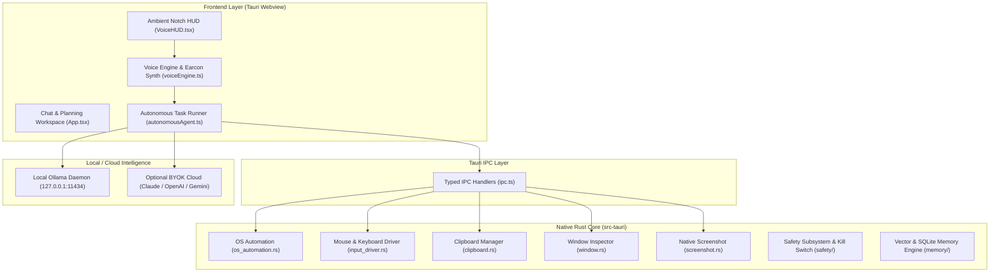

# Aeio Product & Technical Specification
**The Open-Source, Privacy-First AI Voice Operating System**
*Combining VoiceOS Ambient Automation, JARVIS Hands-Free Voice Control, and Claude Desktop Reasoning*

---

## 1. Executive Summary & Vision

Aeio transforms the personal computer into a proactive, voice-driven digital intelligence. 

Traditional operating systems require continuous context-switching: touching the mouse, typing on keyboards, searching tabs, and manually copying data between windows. **Aeio introduces an ambient voice-to-action layer** that controls the operating system, applications, files, and browsers completely hands-free while ensuring **100% local privacy** and zero cloud subscription gatekeeping.

### Core Value Propositions
1. **Zero-Latency Hands-Free OS Control**: Speak to control Spotify, hardware volume, screen locking, app launching, and platform search with sub-millisecond local execution.
2. **System-Wide Ambient Dictation & Editing**: Talk into any text box across macOS and Windows with automatic LLM cleanup, punctuation, and contextual formatting. Highlight any text on screen and speak an edit command to replace it in place.
3. **Autonomous Task Execution**: Formulates multi-step plans and executes research, file operations, web navigation, and tool calls using local open-weight models (Ollama `qwen2.5:7b` / `llama3.2:3b`).
4. **Before It Sends Human-in-the-Loop Guard**: External or destructive actions (sending emails, messages, modifying codebases, running dangerous scripts) pause execution to display an interactive confirmation card on the ambient HUD.
5. **Open Ecosystem & MCP**: Plug-and-play compatibility with Model Context Protocol (MCP) servers, allowing users and developers to add custom integrations with zero vendor lock-in.

---

## 2. Competitive Benchmarking

| Feature | VoiceOS (WakoAI / YC W25) | JARVIS (Demo Model) | Apple Siri / Windows Copilot | **Aeio (Our Product)** |
| :--- | :--- | :--- | :--- | :--- |
| **Privacy / Cloud Dependency** | 100% Cloud-dependent | Cloud API dependent | Proprietary Cloud | **100% Local-First / Zero Cloud Lock-in** |
| **Pricing Model** | $29.99 / month | DIY / Custom | $20/mo subscription | **Free & Open Core / BYOK Optional** |
| **System-Wide Dictation** | Yes (Cloud) | No | Basic OS speech | **Yes (Local LLM formatting + instant paste)** |
| **In-Place Selection Edit** | Yes (Cloud) | No | No | **Yes (Universal clipboard replacement)** |
| **Hardware / OS Control** | Limited SaaS only | Audio / Spotify / Shell | Limited OS settings | **Comprehensive (Spotify, Audio, Screen, Shell, Apps)** |
| **Developer Tools (Terminal/Git)** | None | Partial | None | **Full (Shell, Git, File diffs, Code sandbox)** |
| **Extensibility** | Composio SaaS / Cloud MCP | Hardcoded scripts | Closed ecosystem | **Native Local & Remote MCP Protocol** |
| **Interface** | Floating notch only | Terminal / Audio only | Sidebar | **Dual: Ambient Glass Notch HUD + Deep Chat Workspace** |

---

## 3. Product Features & User Experience

### 3.1 The Ambient Notch HUD (Floating Lens)
* **Visual Identity**: Obsidian dark glass capsule with subtle backdrop-blur and border highlights.
* **Dynamic Waveform**: 5-bar responsive audio visualizer that reflects mic activity in real time.
* **Live Transcription**: Sub-word streaming transcript rendering with zero flicker.
* **Earcon Audio Feedback**: Procedurally synthesized dual-frequency chimes using the Web Audio API:
  - *Wake Chime*: Harmonious upward sweep (440 Hz $\to$ 880 Hz).
  - *Confirmation Chime*: Dual-tone chord (587 Hz $\to$ 880 Hz).
  - *Warning / Pause*: Soft descending pulse (440 Hz $\to$ 220 Hz).

### 3.2 System-Wide Dictation Mode
* **Shortcut**: `Cmd+Shift+D` or double-tap `Fn`.
* **Workflow**:
  1. User speaks freely into their microphone.
  2. Audio is captured locally and transcribed.
  3. Formatted by a local small LLM: removes filler words (*"uh"*, *"like"*, *"um"*), adds punctuation, formats numbers, and structures bullet points or paragraphs.
  4. Automatically injected into the active text field via `write_clipboard` + simulated `Cmd+V` (or `Ctrl+V`).

### 3.3 Contextual Selection Rewriter (In-Place Voice Edit)
* **Shortcut**: `Cmd+Shift+E`.
* **Workflow**:
  1. User highlights text in any application (Slack, Chrome, VS Code, Notes).
  2. User speaks an edit command: *"Make this formal"*, *"Summarize into 3 bullet points"*, *"Translate to Spanish"*.
  3. Aeio simulates `Cmd+C` $\to$ reads selection from clipboard.
  4. LLM rewrites the text in accordance with the user's spoken intent.
  5. Aeio updates the clipboard and simulates `Cmd+V`, replacing the highlighted text in place within 100ms.

### 3.4 Sub-Millisecond Native OS Automation (Fast Path)
* **Regex Engine**: Matches high-frequency everyday actions in <1ms without LLM latency:
  - **Spotify Controls**: *"Play [track/artist] on Spotify"*, *"Pause"*, *"Resume"*, *"Next track"*, *"Previous track"*.
  - **Audio Output**: *"Set volume to [0-100]%"*, *"Mute volume"*, *"Unmute sound"*.
  - **Security**: *"Lock my computer"*, *"Lock screen"*.
  - **Platform Search**: *"Search YouTube for [query]"*, *"Search Google for [query]"*, *"Search ChatGPT for [query]"*.

### 3.5 Autonomous ReAct Agent Loop
* **Workflow**:
  1. **Goal Ingestion**: Natural language input from voice or chat.
  2. **Plan Generation**: Structured multi-step task decomposition.
  3. **Execution Loop**:
     - *Think*: Decides next single atomic action.
     - *Act*: Invokes tool with typed parameters.
     - *Safety Check*: If destructive or external, triggers HUD confirmation.
     - *Observe*: Receives tool output.
     - *Verify*: Checks if the step succeeded or requires recovery.
  4. **Spoken Completion Report**: Summarizes final result via voice synthesizer and records step timeline in chat history.

### 3.6 "Before It Sends" Safety & Approval Cards
* **Philosophy**: Nothing that affects external systems or deletes data executes without explicit operator approval.
* **Triggers**:
  - Sending Slack messages or Gmail emails.
  - Deleting files or executing non-read-only shell scripts.
  - Modifying calendar events.
* **UI**: Floating HUD renders an approval card showing targets, content diffs, and `[Cancel]` / `[Approve]` buttons.

---

## 4. Technical Architecture

### 4.1 System Topology

### 4.2 Tech Stack Selection
* **Desktop Application Shell**: **Tauri 2.0 (Rust)**. Chosen over Electron for 90% lower memory footprint (<40MB RAM idle vs 400MB+ in Electron) and native multi-threaded OS hooks.
* **Frontend**: **React 18 + TypeScript + Vite**. Zero bloated CSS frameworks; pure CSS variables and hardware-accelerated transforms (`translate3d`, `backdrop-filter`).
* **Input Injection**: **Enigo (Rust)** for cross-platform hardware mouse and keyboard event simulation.
* **Clipboard Management**: **Arboard (Rust)** for reliable multi-platform text copying and pasting.
* **Local Intelligence Runtime**: **Ollama** running locally on `http://127.0.0.1:11434`.
* **Primary Local Model**: `qwen2.5:7b` (ideal balance of tool-calling accuracy, multi-step planning, and CPU inference speed on Intel/Apple Silicon).
* **Audio Synthesis**: Native **Web Audio API** (zero asset loading latency, infinite pitch and timbre modulation).
* **Tool Standard**: **Model Context Protocol (MCP)** specification.

---

## 5. Security & Safety Architecture

1. **Hardware Kill Switch**:
   - Atomic flag `HALT_TRIGGERED` monitored on every single step.
   - Global emergency hotkey (`Esc` hold or UI click) instantly aborts running agent execution in <1ms.
2. **Destructive Command Guard**:
   - Shell commands matching dangerous patterns (`rm -rf`, `sudo`, `dd`, `mkfs`, `chmod 777`) are strictly intercepted and refused without explicit operator override.
3. **Audit Trail**:
   - Every executed action, tool argument, timestamp, and visual confirmation is hashed and persisted into an append-only SQLite audit log.

---

## 6. Commercialization & Startup Roadmap

### Phase 1: MVP & Founder Launch (Weeks 1–4)
* Full voice-controlled OS automation (Spotify, volume, web search, system lock).
* Ambient Notch HUD with live waveform and earcon synthesis.
* ReAct autonomous task loop connected to local Ollama.
* System-wide dictation and in-place selection rewriter.

### Phase 2: Power-User & Developer Release (Weeks 5–8)
* Stdio-based MCP server integration (`aeio add mcp`).
* Headless browser automation and web page extraction.
* Visual screenshot grounding (computer-use fallback).
* Custom wake-word engine.

### Phase 3: Commercial Pro & Team Edition (Weeks 9–12)
* Optional hosted ultra-low-latency cloud speech recognition.
* 1-click Composio SaaS OAuth integration (Slack, Google Calendar, Notion, Gmail).
* Cloud memory synchronization across developer machines.
