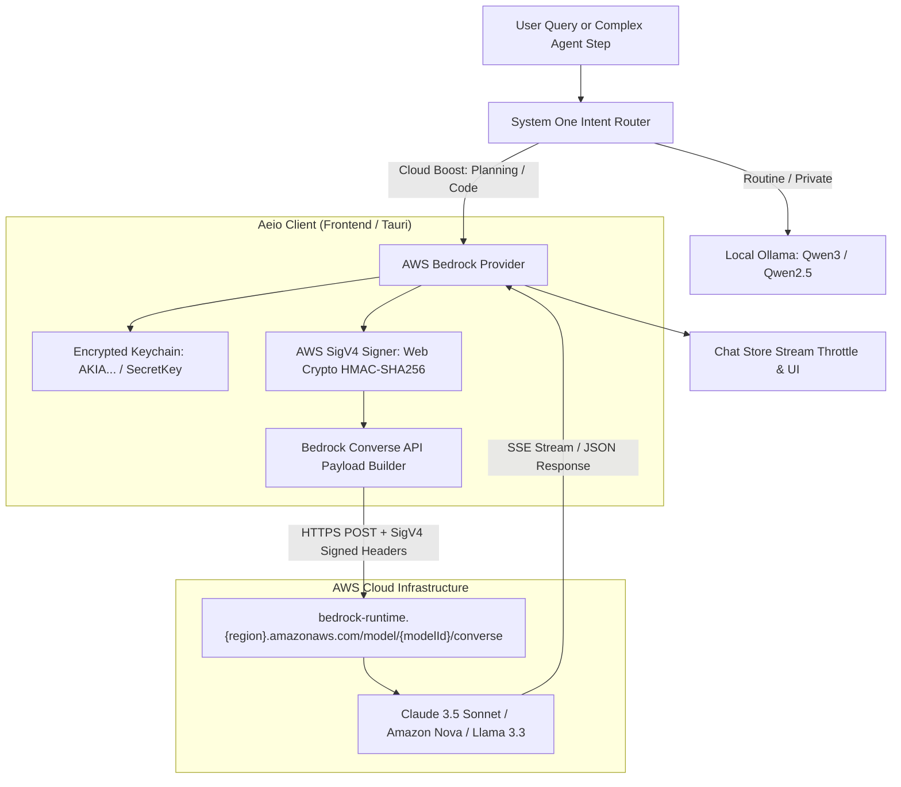

# AWS Bedrock Integration Specification for Aeio

**Status:** Approved / Architecture Design  
**Author:** Aeio Core Team  
**Date:** October 2026  
**Target:** Aeio v0.2.0 (Frontier Cloud & Enterprise Tier)

---

## 1. Executive Summary & Motivation: Why AWS Bedrock?

Aeio was built on a strict **local-first philosophy**: routine tasks, OS commands, volume adjustments, and personal notes run 100% locally on Ollama (`qwen2.5:7b` / `qwen3:8b` / `qwen3:14b`). 

However, complex multi-step autonomous planning, deep architecture refactoring, and complex coding workflows benefit substantially from **frontier reasoning models** (such as Claude 3.5/3.7 Sonnet). 

While Aeio already supports direct Anthropic and OpenAI BYOK keys, **AWS Bedrock** provides unique, indispensable advantages for professional developers, startup teams, and enterprise users:

### 1.1 Enterprise Billing, Startup Credits & Consolidated Invoicing
- **AWS Activate & Enterprise Credits**: Thousands of software developers and startups have $10,000 to $100,000+ in AWS cloud credits. Direct API keys to Anthropic/OpenAI require separate credit card billing; Bedrock allows using existing AWS cloud credits directly.
- **Single Billing Consolidated Dashboard**: Zero fragmented billing across disparate vendor portals. All LLM compute appears in standard AWS Cost Explorer.

### 1.2 Enterprise Data Privacy & Zero-Training Guarantees
- **Strict VPC Boundary**: Model invocations happen within the customer's selected AWS region (`us-east-1`, `us-west-2`, `ap-south-1`, `eu-central-1`, etc.).
- **Zero Training on Customer Data**: AWS Bedrock explicitly contractualizes that customer inputs, outputs, and embeddings are **never used to train any base or third-party models**, adhering to SOC 1/2/3, ISO 27001, and HIPAA compliance requirements.

### 1.3 Unified Access to Multi-Vendor Frontier Models
Instead of managing distinct API integrations, AWS Bedrock unifies:
- **Anthropic Claude**: Claude 3.5 Sonnet v2, Claude 3.7 Sonnet, Claude 3.5 Haiku.
- **Amazon Nova**: Nova Pro (high intelligence, cost-effective multimodal), Nova Lite (sub-second fast responses), Nova Micro.
- **Meta Llama**: Llama 3.3 70B, Llama 3.1 8B/70B/405B.
- **Mistral AI**: Mistral Large 2, Pixtral Large.

### 1.4 Superior Rate Limits & Provisioned Reliability
- Avoids Tier-1/Tier-2 rate limit throttles (HTTP 429) often encountered with direct retail Anthropic/OpenAI accounts during intensive autonomous multi-step agent plan execution.

---

## 2. Technical Architecture: How We Are Using AWS Bedrock



### 2.1 The Bedrock Converse API
Rather than maintaining separate request/response schemas for each model family (Anthropic format vs Llama format vs Nova format), Aeio uses the **AWS Bedrock Converse API** (`/model/{modelId}/converse` and `/model/{modelId}/converse-stream`):
- Standardized request format:
  ```json
  {
    "messages": [
      {
        "role": "user",
        "content": [
          { "text": "Analyze this code..." },
          { "image": { "format": "png", "source": { "bytes": "<base64>" } } }
        ]
      }
    ],
    "inferenceConfig": {
      "maxTokens": 4096,
      "temperature": 0.7
    },
    "system": [{ "text": "System prompt..." }]
  }
  ```
- Standardized response schema returning `output.message.content[].text`.

### 2.2 Native AWS SigV4 Request Signing (Zero External Runtime Bloat)
AWS Bedrock requires all requests to be signed using **AWS Signature Version 4 (SigV4)**.
To maintain a lightweight footprint without pulling in heavy external AWS SDK binaries:
- We implement a zero-dependency, high-speed **SigV4 Signer** using the standard **W3C Web Crypto API** (`crypto.subtle` HMAC-SHA256 and SHA-256).
- Supports:
  - Canonical request generation (Method, URI, Query, Canonical Headers, Signed Headers, Hashed Payload).
  - String-to-sign calculation with ISO-8601 timestamps (`YYYYMMDD'T'HHMMSS'Z'`).
  - Derived signing keys: `HMAC(HMAC(HMAC(HMAC("AWS4" + SecretKey, Date), Region), "bedrock"), "aws4_request")`.
  - Header injection: `Authorization`, `X-Amz-Date`, `X-Amz-Content-Sha256`, and optional `X-Amz-Security-Token` (for AWS SSO / STS temporary credentials).

### 2.3 Secure Credential Storage via macOS Keychain
Credentials never touch unencrypted `localStorage`:
- **AWS Access Key ID**: Stored in keychain under target `aws_bedrock_access_key`.
- **AWS Secret Access Key**: Stored in keychain under target `aws_bedrock_secret_key`.
- **AWS Session Token** (optional): Stored in keychain under target `aws_bedrock_session_token`.
- **AWS Region**: Stored in settings store (defaults to `us-east-1` or user-configured `us-west-2`, `ap-south-1`, `eu-central-1`, etc.).

---

## 3. Included Capabilities & Feature Matrix

| Feature | Included Details |
|---|---|
| **Supported Models** | • **Claude 3.5 Sonnet v2** (`anthropic.claude-3-5-sonnet-20241022-v2:0`)<br>• **Claude 3.7 Sonnet** (`anthropic.claude-3-7-sonnet-20250219-v1:0`)<br>• **Claude 3.5 Haiku** (`anthropic.claude-3-5-haiku-20241022-v1:0`)<br>• **Amazon Nova Pro** (`amazon.nova-pro-v1:0`)<br>• **Amazon Nova Lite** (`amazon.nova-lite-v1:0`)<br>• **Meta Llama 3.3 70B** (`meta.llama3-3-70b-instruct-v1:0`) |
| **Token Streaming** | Real-time token streaming with throttle debouncing directly to the chat bubble. |
| **Multimodal Vision** | Full support for screenshot analysis and Active Screen Inspector (`inspectActiveScreen`) via Bedrock image content blocks. |
| **STS / Temporary Credentials** | Full support for `X-Amz-Security-Token` for developers using `aws sso login` or temporary IAM role assumption. |
| **Settings Management** | Dedicated configuration card in Settings (`⌘,`):<br>• Region selector dropdown<br>• Access Key ID & Secret Access Key password fields<br>• Session Token toggle/input<br>• Model selection dropdown with preset pills<br>• Real-time "Test Connection" button |
| **Model Selector** | Instant selection from top navigation dropdown (`AWS Bedrock`). |
| **Router Cascade** | Seamless integration with `orchestrateChat`: when Bedrock is configured and a task is classified as `cloud_boost`, Bedrock is prioritized with graceful fallback to local Ollama if offline. |

---

## 4. Implementation Plan & Work Breakdown

### Phase 1: Cryptographic SigV4 Engine
- Create `src/lib/providers/awsSigV4.ts`:
  - `signAwsRequest()` using native `crypto.subtle`.
  - Computes `CanonicalRequest`, `StringToSign`, derived signing keys, and `Authorization` header.
  - Generates `x-amz-date` and `x-amz-content-sha256`.

### Phase 2: Bedrock LLM Provider
- Create `src/lib/providers/bedrock.ts`:
  - Implements `LLMProvider` interface (`id: 'bedrock'`, `name: 'AWS Bedrock'`).
  - Supports Bedrock Converse API endpoint resolution based on configured region.
  - Formats user/assistant messages and multimodal vision images.
  - Implements `checkHealth()` verifying AWS credentials against Bedrock.
  - Implements streaming chunk parsing.

### Phase 3: Keychain, Types & Settings Store
- Update `src/stores/settingsStore.ts`:
  - Add `'bedrock'` to `LLMProviderType`.
  - Add `bedrockRegion: string` (default: `'us-east-1'`).
  - Add `bedrockModel: string` (default: `'anthropic.claude-3-5-sonnet-20241022-v2:0'`).
- Update `src/lib/ipc.ts`:
  - Add keychain helpers for `aws_bedrock_access_key`, `aws_bedrock_secret_key`, and `aws_bedrock_session_token`.

### Phase 4: Chat Orchestrator & Multi-Provider Router
- Update `src/lib/providers/orchestrator.ts`:
  - Register `bedrockProvider` in `candidateProviders`.
  - Include Bedrock in `cloudCandidates` cascade when configured with credentials.
- Update `src/lib/providers/index.ts`:
  - Export Bedrock provider and SigV4 utilities.

### Phase 5: UI & Settings Panel Integration
- Update `src/components/chat/ModelSelector.tsx`:
  - Add `AWS Bedrock` option with appropriate badge and model description.
- Update `src/components/settings/SettingsPanel.tsx`:
  - Add dedicated **AWS Bedrock (Enterprise BYOK)** configuration card.
  - Add region selector, credential inputs, preset pills, and connection diagnostic banner.
- Update `src/components/layout/Sidebar.tsx` and `ClaudeTopBar.tsx`:
  - Display active Bedrock model label and badge.

### Phase 6: Automated Verification & Testing
- Create `src/tests/awsSigV4.test.ts`:
  - Test canonical request formatting, HMAC-SHA256 signature derivation against known AWS test vectors.
- Create `src/tests/bedrockProvider.test.ts`:
  - Test message formatting, multimodal image payloads, credential check, and converse response parsing.
- Update `src/tests/orchestrator.test.ts`:
  - Verify routing and fallback when Bedrock is the active or candidate cloud provider.
- Full suite verification: `npm test -- --run` (ensure 100% test pass rate) and `npm run build`.

---

## 5. Security & Privacy Guarantees

1. **Zero Cloud Leakage with `neverSendMemoriesToCloud`**: If the user enables privacy mode, Bedrock is strictly skipped and execution remains 100% on local Ollama.
2. **Encrypted at Rest**: All AWS credentials remain in macOS Keychain and are never written to unencrypted disk, local storage, or telemetry logs.
3. **IAM Least Privilege Recommendation**:
   Recommended minimal IAM policy for the user's AWS credentials:
   ```json
   {
     "Version": "2012-10-17",
     "Statement": [
       {
         "Effect": "Allow",
         "Action": [
           "bedrock:InvokeModel",
           "bedrock:InvokeModelWithResponseStream"
         ],
         "Resource": "*"
       }
     ]
   }
   ```
